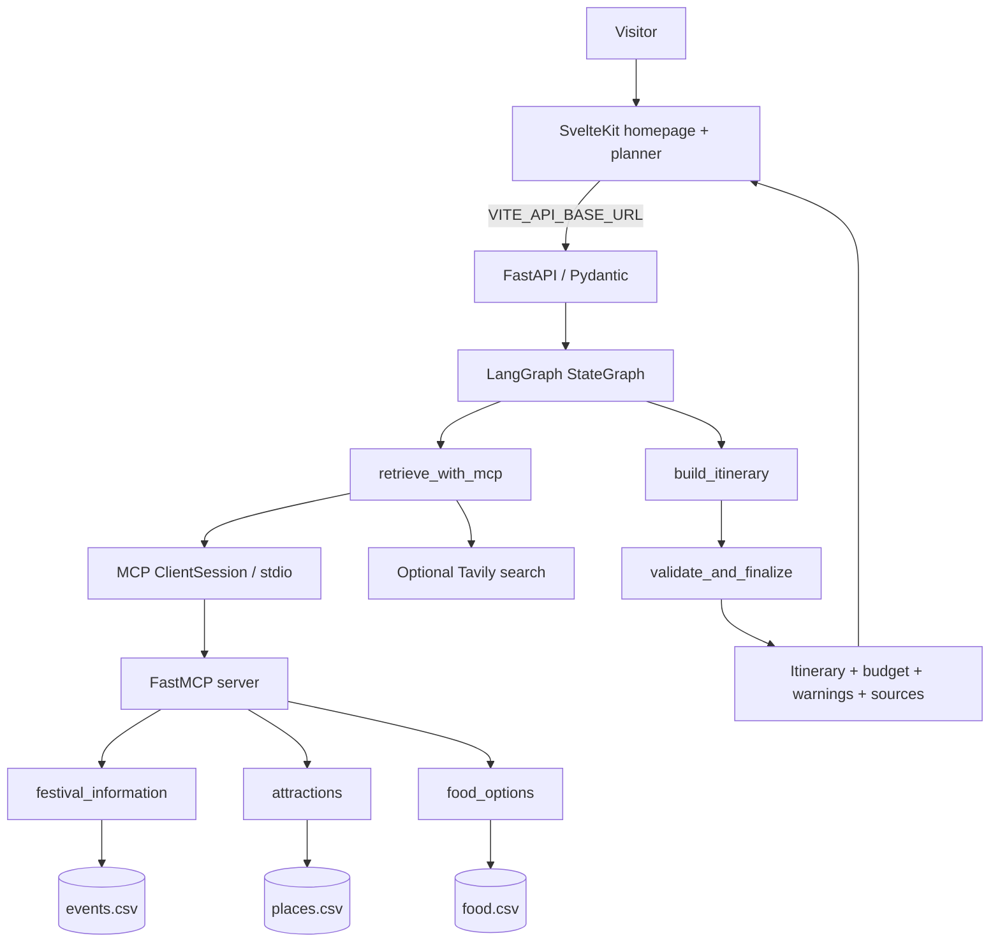

# GoaFest AI — Architecture and Viva Notes

## Architecture diagram

## Framework concepts used

- **Shared state:** `TripState` in `backend/app/state.py` carries the request, research results, CSV records, MCP status, draft and final response.
- **Nodes:** `retrieve_with_mcp`, `build_itinerary`, and `validate_and_finalize` are node functions in `backend/app/graph.py`.
- **Edges:** `START → retrieve_with_mcp → build_itinerary → validate_and_finalize → END` makes the order explicit.
- **Compilation and invocation:** `graph.compile(...)` creates the runnable graph and `graph.invoke(...)` executes it.
- **Checkpointing:** `MemorySaver` stores graph state in memory while the backend process is running; it is not durable persistence.
- **MCP server:** `backend/app/mcp_server.py` uses `FastMCP` and `@mcp.tool()` to expose five tools with input schemas generated from Python annotations.
- **MCP client:** `backend/app/mcp_client.py` launches the stdio server, initializes `ClientSession`, lists tools, and calls tools over MCP. The graph uses the MCP results for CSV-backed festival, attraction and food retrieval.
- **Fallback:** if LangGraph/MCP cannot start, the deterministic planner uses local CSV functions and marks the fallback state in the response. A fallback is not reported as a successful MCP call.
- **Search and evidence:** Tavily is optional; titles, URLs and summaries are retained. Search snippets do not confirm festival dates by themselves.
- **Budget and validation:** Python calculates itemised estimates and checks obvious schedule overlap. No route optimisation is claimed.

## Viva explanation (60–90 seconds)

“GoaFest AI is a festival-centred trip planner. A visitor enters a festival, start date, duration, group size, budget and preferences in a SvelteKit interface. FastAPI validates the request and calls a small LangGraph workflow. The graph passes a shared `TripState` through three nodes: retrieval, itinerary creation, and validation/finalisation. In retrieval, the app creates a real MCP client session to a FastMCP stdio server and calls tools that read event, attraction and food CSV files. It can also call Tavily when a key is configured. The planner combines the returned records into a day-wise itinerary, computes costs using deterministic Python arithmetic, and checks for obvious schedule overlaps and budget overruns. The UI displays sources and warnings, because a sample CSV or search snippet is not proof that a festival is happening at a particular time. If MCP is unavailable, the app reports a fallback instead of pretending that an MCP call succeeded.”

## Demo sequence

1. Open the homepage and browse Explore Goa categories.
2. Use “Use for planning” on a beach, food or event card.
3. Generate a 2–3 day itinerary and inspect day cards, budget assumptions, warnings and sources.
4. Open FastAPI `/docs`, `/catalog` and `/mcp/tools`.
5. If dependencies are installed, invoke `festival_information` with `POST /mcp/tools/festival_information` and a JSON body such as `{"festival":"Goa Carnival"}`.
6. Explain the LangGraph node order, MCP tool invocation and honest fallback status.
