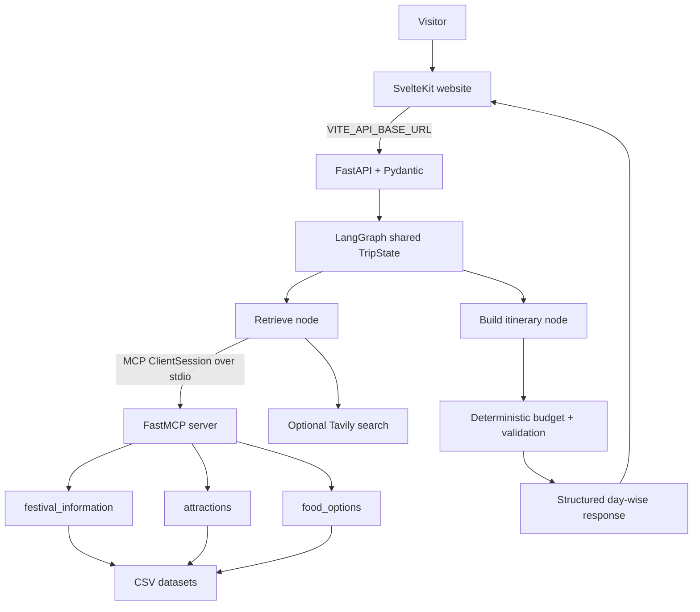

# GoaFest AI

**A Multi-Agent Tourism Coordination System for Festival Visitors in Goa**

GoaFest AI is a student-friendly festival trip planner built with SvelteKit, FastAPI, LangGraph, an actual MCP stdio server, CSV tourism data and optional Tavily web search. The design prioritises a clear itinerary and honest evidence labels: sample dataset entries, estimated prices and unverified festival schedules are never presented as confirmed facts.

## What is included

- Responsive homepage with Goa-inspired visual design and a festival itinerary form.
- **Explore Goa** directory powered by the included CSVs: beaches, tourist places, heritage sites, activities, local food, restaurants, events and transport. Search/filter, Maps search, source links and “Use for planning” actions are included.
- Best-effort image lookup through Wikimedia Commons; unavailable images use a designed fallback. Image source/attribution links are shown where returned.
- FastAPI endpoints: `/health`, `/config`, `/catalog`, `/search`, `/plan`, `/mcp/tools`, and `/mcp/tools/{tool_name}`.
- Three-node LangGraph flow with shared `TripState`: retrieve, build itinerary, validate/finalize.
- Five typed MCP tools exposed over stdio. The LangGraph retrieval node uses a real MCP client session to call the festival, attraction and food tools. If MCP startup fails, a visible fallback status is returned and the planner still uses the CSV functions directly.
- Optional live Tavily search with preserved result titles, URLs and concise summaries. Without a valid key, search status is `unavailable` and no fake search results are inserted.
- Deterministic INR budget calculation and basic schedule-overlap checks.

See [ARCHITECTURE_AND_VIVA.md](ARCHITECTURE_AND_VIVA.md) for a compact diagram, framework mapping and demo script.

## Architecture



## Project structure

```text
GoaFest_AI_Enhanced/
  backend/
    app/main.py          # FastAPI endpoints and CORS
    app/models.py        # Pydantic input validation
    app/state.py         # Shared LangGraph state
    app/graph.py         # LangGraph nodes, edges, compile and invoke
    app/agents.py        # Itinerary assembly
    app/tools.py         # CSV retrieval, budget and validation functions
    app/mcp_server.py    # Real FastMCP stdio server and five tools
    app/mcp_client.py    # MCP protocol client used by graph/API
    app/catalog.py       # CSV-powered Explore Goa endpoint
    app/web_search.py    # Optional Tavily integration
    app/image_search.py  # Wikimedia Commons image lookup
    data/*.csv           # Local tourism datasets, including sourced restaurant links
    tests/test_planner.py
    requirements.txt
    requirements-dev.txt
    .env.example
  frontend/
    src/routes/+page.svelte
    .env.example
    vercel.json
    package.json
  README.md
```

## Run locally in VS Code (Windows PowerShell)

Use Python 3.12 if possible, Node.js 20+ and npm. Open the extracted project folder in VS Code.

### 1. Set up and run the backend

```powershell
cd backend
py -3.12 -m venv .venv
.\.venv\Scripts\Activate.ps1
python -m pip install --upgrade pip
pip install -r requirements-dev.txt
Copy-Item .env.example .env
uvicorn app.main:app --reload --host 127.0.0.1 --port 8000
```

If PowerShell blocks activation, run `Set-ExecutionPolicy -Scope Process -ExecutionPolicy Bypass` and activate again. If `py -3.12` is unavailable, use a supported Python installation with `python -m venv .venv`.

Open `http://127.0.0.1:8000/docs` for interactive API docs.

### 2. Optional live web search

Create a Tavily API key at [app.tavily.com](https://app.tavily.com/) and place it in `backend/.env`:

```dotenv
TAVILY_API_KEY=your_real_key_here
CORS_ORIGINS=http://localhost:5173,http://127.0.0.1:5173
```

The key is optional. Without it, the itinerary still works in fallback mode and the UI explicitly says that live research was unavailable. No LLM API key is required.

### 3. Run the MCP server separately for classroom demonstration (optional)

Open a second VS Code terminal:

```powershell
cd backend
.\.venv\Scripts\Activate.ps1
python -m app.mcp_server
```

This server uses **stdio**; it is not a browser URL and it may appear to wait silently because it communicates over the MCP protocol. Stop it with `Ctrl+C`. The FastAPI app also launches its own short-lived MCP server process when the LangGraph retrieval node invokes tools, so you do not need to leave this manual server running for normal web use.

To inspect tool names and input schemas while FastAPI is running, open `http://127.0.0.1:8000/mcp/tools`. To invoke a tool through the MCP client endpoint, use for example:

```powershell
$body = @{ festival = "Goa Carnival" } | ConvertTo-Json
Invoke-RestMethod -Uri "http://127.0.0.1:8000/mcp/tools/festival_information" -Method Post -ContentType "application/json" -Body $body
```

### 4. Run the frontend

Open a third VS Code terminal:

```powershell
cd frontend
Copy-Item .env.example .env
npm install
npm run dev
```

Open `http://localhost:5173`. The frontend reads `VITE_API_BASE_URL` from `frontend/.env`; local default is `http://127.0.0.1:8000`.

### 5. Test the backend

From `backend/`, with the virtual environment activated:

```powershell
python -m pytest -q
python -c "from app.main import app; print(app.title)"
```

For frontend static analysis and production compilation:

```powershell
cd frontend
npm run check
npm run build
```

## Deployment configuration

Deploy the **frontend and backend as separate services**. Vercel is suitable for the SvelteKit frontend; deploy the FastAPI folder as a Python web service (for example Render, Railway, or another ASGI-capable host). Do not deploy the MCP stdio server as if it were a public HTTP server; the FastAPI backend starts it as a child process when needed.

### Frontend (Vercel)

1. Import the repository/project into Vercel and set the root directory to `frontend`.
2. Set the environment variable `VITE_API_BASE_URL` to the public base URL of the deployed FastAPI service, e.g. `https://your-api-host.example.com` (no trailing slash required).
3. Redeploy after changing the variable; Vite variables are compiled into the frontend at build time.

### Backend (ASGI host)

1. Set the service root directory to `backend`.
2. Install command: `pip install -r requirements.txt`.
3. Start command: `uvicorn app.main:app --host 0.0.0.0 --port $PORT` (use the host's documented port syntax if it differs).
4. Set `CORS_ORIGINS` to a comma-separated list containing the exact deployed Vercel origin and any development origins you still need, e.g. `https://your-project.vercel.app,http://localhost:5173`.
5. Add `TAVILY_API_KEY` only if live web search is required. Keep all secrets in the backend host's environment settings, never in frontend variables or source control.
6. Ensure the host permits child processes and stdio subprocesses. The application can fall back to local CSV tools if MCP startup fails, and the result reports the fallback state.

Verify deployment by opening `/health`, `/docs`, `/catalog` and `/mcp/tools` on the backend, then submit an itinerary from the deployed website. A frontend-only deployment does not make the API available: `VITE_API_BASE_URL` must point to a running backend.

## How LangGraph and MCP work together

- `TripState` is the shared typed state passed between nodes.
- `StateGraph(TripState)` registers three nodes: `retrieve_with_mcp`, `build_itinerary`, and `validate_and_finalize`.
- `add_edge(START, ...)` and node-to-node edges define execution order; `compile()` creates the executable graph; `invoke()` runs it.
- `MemorySaver` is used for in-memory checkpointing when available. It is not durable storage and is lost when the backend process restarts.
- `mcp_server.py` uses `FastMCP` and `@mcp.tool()` to register tools with schemas derived from their typed Python signatures and docstrings.
- `mcp_client.py` launches `python -m app.mcp_server`, initializes a `ClientSession`, discovers/calls the registered tools, and parses structured tool results. The graph retrieval node uses the returned CSV results for the itinerary.
- If MCP cannot be started, the graph's retrieval node calls the same CSV helpers directly and labels the MCP status `fallback`; the UI does not falsely claim the protocol call succeeded.
- Tavily is a separate optional research tool. Its URLs and summaries are preserved; a search snippet is not treated as proof of an event date or venue.

## Viva explanation (about one minute)

“GoaFest AI plans short Goa trips around a festival. The visitor enters the festival, date, trip length, travellers, budget and preferences in a SvelteKit website. FastAPI validates the input and invokes a small LangGraph workflow. The graph shares a `TripState` across three nodes: retrieve, plan, and validate/finalize. The retrieval node opens an actual MCP client session to a FastMCP server and calls typed tools for event records, attractions and food from CSV files. It also queries Tavily when an API key is configured. The planner assembles a day-wise itinerary and uses deterministic Python calculations for the budget and schedule checks. The website displays source links, cost assumptions and warnings for unverified information. MCP failure is visible and has a CSV fallback, so the project remains demonstrable without pretending that every external service succeeded.”

## Honest limitations

- CSV records and prices are starter/demo data, not guaranteed current business listings or quotes.
- Tavily is optional and requires a valid key plus outbound network access. Search results need human verification.
- Wikimedia image lookup is best-effort; a missing image uses a designed fallback. Attribution metadata may require review.
- The itinerary does not confirm festival occurrence, tickets, opening hours, transport schedules, accommodation availability or reservations.
- No live route optimisation or traffic-time calculation is implemented. Google Maps links only open a search.
- The schedule validator catches obvious overlaps and budget overruns; it does not perform reliable automatic replanning around official event schedules.
- LangGraph checkpoints are in-memory only. The project does not use a database, authentication or durable user memory.


### Explore Goa listings and deployment note

The Explore Goa directory reads `frontend/static/data/catalog.json`, generated from the project CSV files. This lets the directory work independently of the Render API. If you edit any CSV in `backend/data/`, regenerate `frontend/static/data/catalog.json` before redeploying the frontend. The trip-planning form still calls the FastAPI backend through `VITE_API_BASE_URL`.
